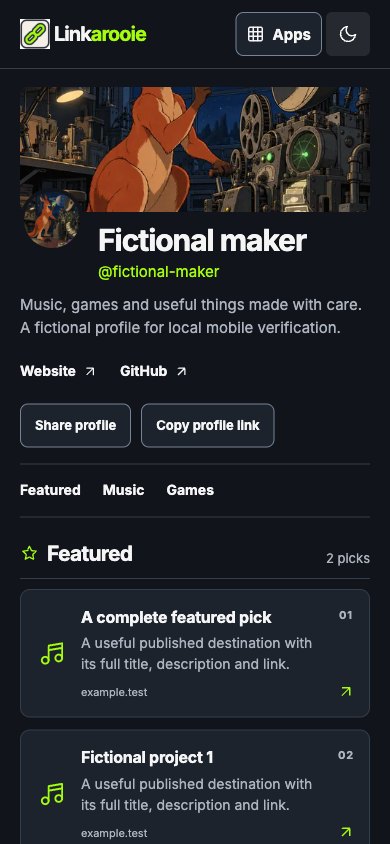

# Linkarooie

Linkarooie publishes a small creator profile and curated collection: write links, group and pin picks, add tags or achievements, and feature approved Guestbook moments. It owns its profile and authored collection; Guestbook retains ownership and approval of source photos. MIT.

[Development commands and checked source ownership](ENGINEERING.md).

`pnpm install --frozen-lockfile; pnpm check; pnpm dev`. Deployment: provision isolated D1, apply `migrations/0001.sql`, set `OWNER_API_TOKEN` with Wrangler secret input, then `pnpm deploy`. No GitHub Actions. Secrets never belong in source.

Versioned app contract: `app.manifest.json`. Linkarooie **consumes** Guestbook’s contract-1 `/api/items` and `/api/items/:id` provider API. It checks current public approval each time a linked moment is resolved. Here / there owns the media and moderation; this repository owns the curated cards and profile, and grants no provider moderation rights. A downloaded public copy cannot be recalled.

Owner entry is `/owner`. This instance sets `OWNER_STUDIO_URL` to its existing Cloudflare-protected Composer editor, selecting this app. The redirect creates no app session and grants no API permission. Independent installations omit that optional variable and retain the local runtime-credential studio. Public registration is not added. Public browsing works without Composer. The studio is owner-only; photos are uploaded and moderated in Guestbook. No anonymous multi-tenant promise is added. Composition mounts this service under its manifest route. Data remains with the app, never inside Composer.

This is the actual public app with a fictional local profile and collection.

## Public project standard

Reviewed 13 October 2026. The app supplies saved reader dark/light themes, native app navigation with Ctrl/Cmd+K and ordinary links, visible keyboard focus, phone layouts, favicon/touch icon and page-specific social metadata. Original ink-line cel animation App Composer artwork is retained with its recorded request and file inventory (hashes in `docs/brand/provenance.md`; the request record lives in the owning App Composer repository); functional icons remain vectors. These features do not widen signup, owner access or disclosure permissions.

Contributions: [Contributing](CONTRIBUTING.md), [Code of Conduct](CODE_OF_CONDUCT.md), [Security](SECURITY.md), [Accessibility](ACCESSIBILITY.md). Physical-device, screen-reader and full platform sharing acceptance remain distinct from browser checks.

Public collections include search, photo/link filters, destination previews and a clear app explanation. Reviewed 17 October 2026: search and its status appear only when more than one item is published, the count stays silent until someone types or filters, and the jump nav disappears when there is nothing to jump to, so no control implies content. Navigation uses original app thumbnails and retains Composer's theme/links when mounted; standalone themes remain app-owned. The invited studio and current-source visibility checks are unchanged.

## Health and optional usage

Reviewed 14 October 2026. `GET /healthz` (or the declared mount plus `/healthz`) returns public liveness and exact source revision. It does not query storage, inspect credentials or prove a full user journey. `HEAD` is supported; other methods return 405.

Optional server-only daily counts use `USAGE_ENDPOINT` (an explicit HTTPS app-scoped endpoint) and `USAGE_TOKEN` (a write-only runtime secret). Both are absent by default, so forks remain independent. The copied MIT publisher derives from App Composer `lib/usage/publisher.mjs`; it is owned and deployable here, without a Composer package or Woodhouse runtime dependency. Failure or a 1.5-second timeout drops a count without blocking the app; there are no retries. Only successful public home-page opens are published. No visitor, URL, referrer, entered text, identity, profile, filename or passphrase is sent. `X-Composer-Verification: 1` excludes synthetic release probes.

The launch operator enables its own instances through Wrangler secrets; do not copy those secrets into a fork. The public [app activity](https://composer.loftwah.com/activity) explains retention, limits and missing-count/bot caveats.

Add `?vitals=1` to the public page, then open “Page performance” for local LCP/INP/CLS measurements. Values apply to this load only; unsupported metrics say unavailable. The self-hosted standard `web-vitals` 6.2.3 bundle and Apache licence/provenance are retained. No values, element attribution or page data are uploaded or persisted. Developer console links stay public and do not print app contents.

Original editorial presentation, reviewed 14 October 2026: app-specific illustrated hero and sharing artwork, responsive 480/960px WebP sources, reserved image dimensions, clear collection/story sections and native browse/contribute actions. Illustration is labelled separately from published contributions. Mounted social URLs resolve inside the app mount. Owner titles, introductions, layouts, moderation, data and configuration contracts are preserved. Asset provenance and optimisation are recorded beside each derivative.

The protected collection studio edits existing authored titles, descriptions and HTTPS destinations, previews unsaved cards without network fetching, and saves with explicit visibility. Source-backed photo content stays owned by its provider. Reordering waits for a successful server response before changing the visible order; failures leave the current order intact.

## Profile and link presentation

Reviewed 15 October 2026. The title and introduction become the profile name and bio. The owner studio adds an optional handle and Website/GitHub/Bluesky/LinkedIn addresses. Empty optional links disappear. Addresses require HTTPS without embedded credentials; named social services require their own reviewed hostnames. Older configuration clients preserve these additional fields.

Choose compact layout for a text-first collection, or retain the existing gallery/editorial layouts. Each current card has an independent fixed icon and pin control. Pinned public cards come first while original position/id order remains stable inside each group. Private and revoked cards remain excluded. Saving a link style changes neither its content nor publication state. The existing private export includes those fields. All records stay in this app's D1; no schema migration is needed.

Sharing uses the published server canonical URL with native share where available, then clipboard/manual-copy recovery. Cancelled native sharing records no success or conversion. No external destination is fetched for previews, and no visitor/action tracker was added. Exact source references, reuse and deferred features are in [the provenance matrix](docs/linkarooie-provenance.md).

## Guarded owner link edits

Reviewed 15 October 2026. Owner `POST /api/cards` accepts an optional `expected` object containing the exact saved `title`, `description`, `url` and `status`. With that object, the card must be manually authored; one atomic SQL update compares all four stored values and returns 409 if another save, hide or removal intervened. Order and presentation remain separate. Existing clients without `expected` retain their existing update semantics; no schema or data-version change is required.

New destination writes are limited to 2,048 characters after URL canonicalisation. Guarded comparison accepts an existing URL up to 24,576 characters without truncation so an older oversized Unicode destination can be repaired. Card request bodies remain bounded at 32 KiB; other card-management actions retain their existing bounds. No URL is fetched to save or compare it. Real SQLite tests cover concurrent hiding at the SQL boundary, source-owned refusal, malformed compare data and legacy URL repair.

The standalone collection studio sends this exact saved snapshot too. A conflict keeps the owner's unsaved fields, loads the current private record for a text-only comparison and requires Use saved link or Keep my edits before another save. Failed comparison offers an explicit read-only retry; removed/replaced records retain copyable text with saving blocked. Saved snapshots are JSON-encoded before HTML escaping so line endings and owner text remain exact and inert.

Authored saves update their own form and row in place, preserving other card edits. Card/content, style, reorder and add/feature operations share one mutation lock; pending card fields cannot be edited or resubmitted, and previously disabled/conflicted controls remain disabled after recovery. Actual delayed-response browser acceptance remains a separate release gate.

The standalone studio warns before a reload/navigation while card text, icon/pin or add/feature fields differ from their saved/displayed baseline, or a card mutation is pending. Returning to the saved values removes that warning. Successful content/style saves and explicit saved-version recovery advance only their own baseline; saving one card cannot silently discard another card's edits. A completed navigation still does not persist private drafts.

Legacy updates now patch only supplied content fields in the atomic SQL statement. In particular, a publish/hide request cannot restore an older title, description or destination read before a concurrent guarded edit. Existing explicit-field and default-visibility semantics remain; exact four-field conflict detection still requires `expected`. A real SQLite interleaving test pauses the older visibility write, saves newer guarded content, then proves the visibility write preserves all newer content.

## Milestones and credits

The owner studio adds up to eight achievements independently of the eight link cards. Each has a title, optional description/date/HTTPS destination, a fixed icon and draft/published/hidden visibility. A known year, month or calendar day stays at that precision; unknown dates disappear. Empty public achievement sections disappear too. New entries must first save as drafts. Publishing or saving published changes is explicit; this is not a revision-history system.

Owner `POST /api/achievements` accepts `action` (`create`, `edit`, `visibility`, `reorder` or `delete`) and the current `expectedRevision`, plus the action's supported fields. An atomic compare of the app-owned settings row refuses stale writes, including simultaneous first saves. Failed or conflicting saves keep local text for comparison; ambiguous new-draft results require checking the saved list before starting again. Private drafts are never persisted in browser storage. Public `GET /api/achievements` and homepage markup contain only published entries. The private export adds `achievementCollection` version 1; an unreadable collection reports `achievementProblem: review_required` without replacing it or blocking export of the existing cards/settings. No schema migration or new capability is required.

## Public sharing and link presentation

MP direction, 16 October 2026: links use no underlines and retain visible keyboard focus. Page, Open Graph and X titles/descriptions agree; the app serves an explicit large-image card with dimensions, type and alt text. The normal release checks live public HTML and JPEG dimensions with a marked Twitterbot user-agent probe. Actual X rendering is a separate observation; a probe alone does not establish it.

## Tags with useful context

A profile can hold up to twelve short tags independently of its cards and milestones. Plain labels remain text. Optional explanation, source and related-work links use native disclosures that work by touch and keyboard without hover; Escape closes the active tag and returns focus to its summary. All content is escaped text, and references require HTTPS without embedded credentials. No destination is fetched for preview, citation verification or decoration; an authored source link is not a verified factual claim.

The owner studio uses one inline tag editor with private drafts, explicit publishing/hiding, stable ordering, retained edits and saved-version comparison. Reference validation remains visible outside the optional reference disclosure, including restored edits. Saving published changes takes effect immediately. The existing mutation lock and unload protection cover tags too; private drafts are never persisted in browser storage.

Owner `POST /api/tags` accepts `create`, `edit`, `visibility`, `reorder` or `delete`, the current `expectedRevision` and only the action's supported fields. Commands are bounded at 16 KiB; the versioned app-owned settings row is bounded at 160 KiB to accommodate all twelve maximum-sized records, including JSON escaping. Labels are at most 40 characters, explanations 240, reference labels 100 and each canonical HTTPS URL 2,048. Exact-byte atomic comparison refuses competing first saves and stale changes without overwriting cards, settings or milestones. Public `GET /api/tags` and homepage HTML expose only published tags. Private export adds `tagCollection` version 1; malformed saved data reports `tagProblem: review_required` while preserving it and keeping other content exportable. No new database, migration or provider is introduced. Manifest `tagCollection` version 1 advertises the reviewed bounded context; native Composer controls remain off for older source pins.

Release acceptance includes public keyboard/Enter/Escape/focus behaviour at phone and desktop widths in both themes, owner recovery and exact source activation. App Composer #11 records the actual deployed versions; a unit check alone is not release evidence.

## Portable profile settings

This feature covers profile presentation settings, not a complete collection backup or restore. Existing owner records, moderation/publication states, provider references, media, milestones, tags and private owner extensions stay outside the file. The existing private collection export remains separate.

Owner `GET /api/profile-settings` downloads a JSON attachment with exactly `format: "linkarooie.profile-settings"`, `version: 1` and `config`. The configuration contains the title, introduction, theme, layout, handle and four supported social/website addresses. Unknown or credential fields, code modules, unsupported versions, unsafe or credential-bearing URLs and files beyond 32 KiB are refused. The app does not execute a file or fetch its destinations.

Owner `POST /api/profile-settings` with `{action: "review", file}` returns `before`, `after` and `changedFields` without writing. Applying is explicit: `{action: "apply", file, expected: review.before}` compares the reviewed settings with current saved values, then atomically compares the exact stored row before replacing only those presentation fields. Cookie requests require the same origin; the private bearer credential remains available to the operator. Commands are bounded at 64 KiB. Stored app-owned extensions remain preserved and excluded from the portable file.

The owner studio's optional “Move profile settings” section downloads the file and shows a text-only saved/file comparison before an explicit Apply. It retains the selected file after errors and requires a fresh read-only review after conflicting or uncertain saves. Unsaved profile-form edits block applying a file; other collection drafts remain in place. File data stays in memory, with no browser-storage persistence. The existing shared mutation lock and native unload warning cover this flow. These are source behaviors pending actual interaction and finish review.

Ordinary `/api/config` writes use the same exact-byte comparison, so an older form save cannot overwrite an import committed after its read. A conflict returns 409; an uncertain storage result returns a bounded recovery message without retrying. Malformed or oversized stored settings remain untouched for owner review. No endpoint grants guest access, imports records or establishes full recovery acceptance. Native Composer and standalone browser qualification cover download/review/apply, invalid files, retained app-switch drafts, unsaved-settings protection, conflict/re-review, cancel focus, exact downloaded bytes and non-settings preservation. Both themes and phone/desktop layouts are checked. Actual production identities and native host authentication evidence remain separately recorded in App Composer #11.

Native Composer parity: manifest `profileSettings` version1 advertises the fixed `linkarooie.profile-settings` format and32KiB file limit (manifest1.4.0/dataVersion1). Composer keeps controls and bridge actions disabled on older source pins. Pure configuration/file validation is separately reusable MIT source in `public/brand/profile-settings-fields.mjs`; the existing profile API re-exports the same behavior. No new resource, migration, credential or live activation is introduced by this descriptor.

## Creator profiles

The optional `profile` layout uses an owner-selected portrait, banner and social preview, eight featured picks and grouped Music/Games/Projects/Writing/Connect discovery across up to 64 existing cards. Reviewed 17 October 2026: every section title leads with the fixed symbol of the group it names, the symbol set now includes `game` and `star` (existing `heart` styles keep rendering), and the phone hero is compressed with a single scrolling jump row so featured picks arrive sooner. Other layouts and source-controlled photo eligibility remain available. Configure image URLs and X in the owner studio or the reviewed Composer settings; images require public HTTPS addresses. No personal creator is the default. See [asset provenance and settings-file scope](docs/brand/provenance.md). Exact release and current reference curation evidence belongs in Composer issue11.

The shared header keeps theme switching as a quiet current-mode sun/moon icon. Preserve the stable Dark theme accessible toggle name, pressed state, keyboard focus, 44px target and existing saved-preference key. Keep the secondary control class so light-theme primary-button rules cannot override its foreground.

Featured profile picks are shortcuts, not a separate category: each eligible card also appears under its assigned group. Search counts unique card IDs across the repeated views, so a featured game still belongs under Games without inflating the item count, and the count itself stays quiet until a visitor filters.

## Shared Apps launcher

The committed `public/brand/launcher.js` and `launcher.css` follow Composer's maintained launcher contract. The controller is generated from Composer's strictly checked `src/browser/launcher.ts`; app destinations, theme keys and gallery filters stay local. Review and copy updates with Composer's explicit `pnpm ui:assets --check|--write /absolute/this-checkout`, then run this app's checks and release independently. No runtime Composer asset dependency or automatic update is added.
